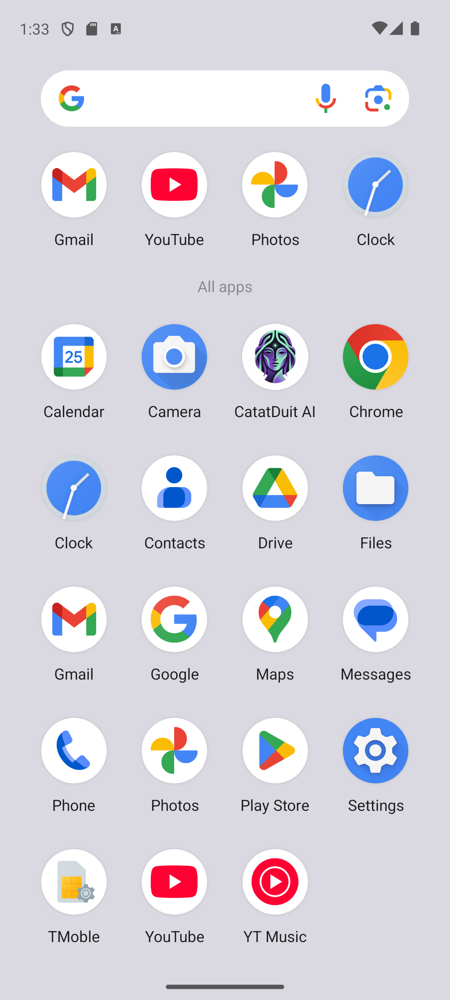
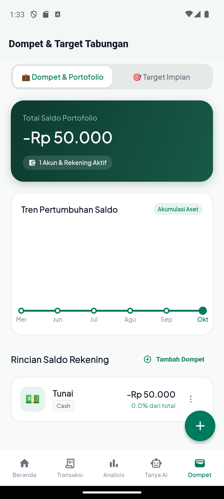
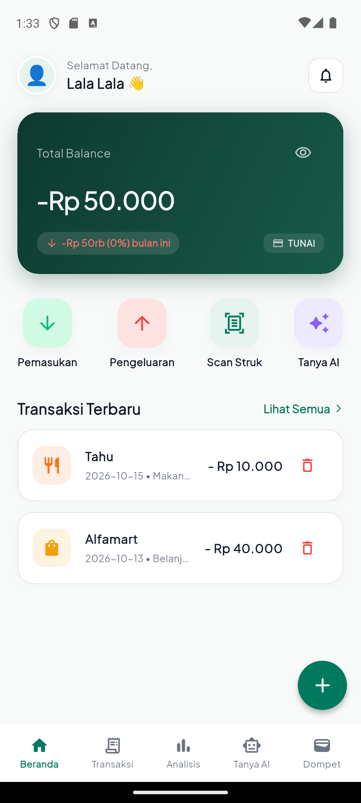
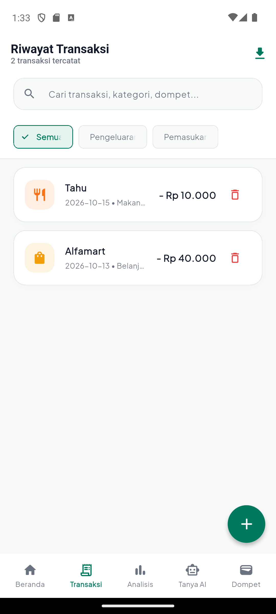
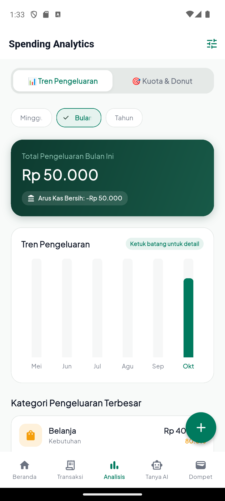
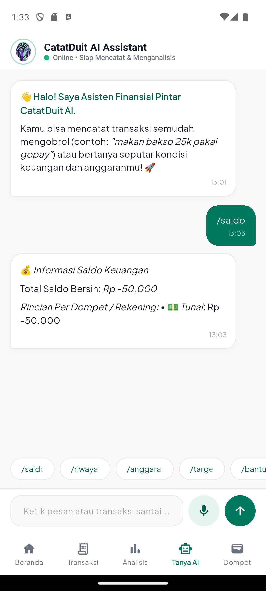
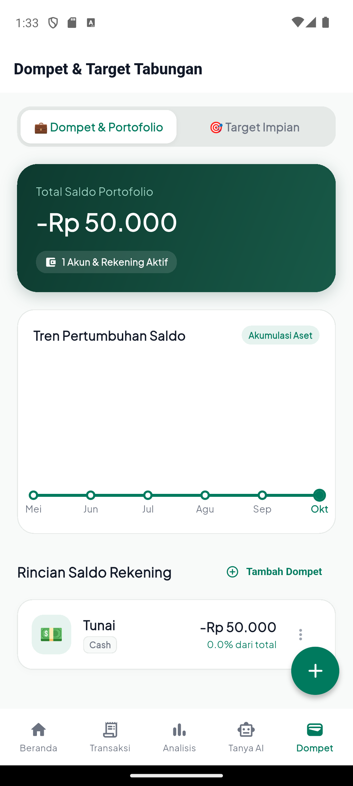

# 💰 CatatDuit AI — Aplikasi Pengelola Keuangan Pribadi Berbasis AI

<p align="center">
  
</p>

<p align="center">
  <a href="release/CatatDuitAi-v1.0.0.apk?raw=true"></a>
  <a href="USER_GUIDE.md"></a>
  <a href="LICENSE"></a>
</p>

<p align="center">
  
  
  
</p>

---

## 🌟 Tentang CatatDuit AI

**CatatDuit AI** adalah aplikasi asisten finansial cerdas untuk Android yang dirancang untuk memudahkan Anda mengelola pemasukan, pengeluaran, portofolio dompet, kuota anggaran bulanan, dan tabungan impian dengan bantuan teknologi **Kecerdasan Buatan (AI)**. 

Aplikasi ini terhubung langsung secara **omnichannel** dengan **Bot Telegram**, memungkinkan pencatatan instan melalui percakapan santai, pesan suara (*voice note*), pemindaian struk belanja fisik menggunakan kamera (*OCR*), hingga konsultasi strategi finansial pribadi.

---

## 📥 Unduh Aplikasi (Download APK)

Anda dapat mengunduh installer APK resmi langsung dari repositori ini:

| Berkas Installer | Versi | Ukuran | Tautan Unduh Langsung |
| :--- | :---: | :---: | :--- |
| **`CatatDuitAi-v1.0.0.apk`** | `v1.0.0` | 56.0 MB | [⬇️ **Download File APK Langsung**](release/CatatDuitAi-v1.0.0.apk?raw=true) |

### 🛡️ Verifikasi Integritas File (SHA-256 Checksum)
Untuk menjamin keaslian dan keamanan berkas installer, Anda dapat mencocokkan nilai hash SHA-256:
```text
66b2190fe7db0e07cdc5b4b97ec80bea8874f928c158fbe9ae6b3cf6e310ab49
```
*(Lihat juga berkas [SHA256SUMS.txt](SHA256SUMS.txt))*

---

## ⚡ Panduan Instalasi & Login Cepat

### 1. Pemasangan Aplikasi di Ponsel (Sideloading):
1. Unduh berkas [`CatatDuitAi-v1.0.0.apk`](release/CatatDuitAi-v1.0.0.apk?raw=true).
2. Buka file hasil unduhan di perangkat Android Anda.
3. Jika muncul dialog perizinan sistem, aktifkan opsi **"Izinkan penginstalan aplikasi dari sumber ini"** (*Allow from this source*).
4. Ketuk **Instal** dan tunggu hingga proses selesai.

### 2. Penautan Akun & Login OTP Telegram:
1. Buka aplikasi **CatatDuit AI** di ponsel Anda.
2. Buka Bot Telegram CatatDuit, lalu kirim perintah:
   ```text
   /link
   ```
   *(atau cukup kirim perintah `/kode`)*
3. Bot akan mengirimkan **6-digit kode OTP** (berlaku selama 5 menit).
4. Masukkan kode tersebut ke dalam aplikasi Android lalu ketuk **"Verifikasi & Hubungkan"**.
5. Anda akan langsung masuk ke beranda portofolio keuangan Anda!

> 📖 Untuk panduan mendalam dan langkah bergambar, buka [**📘 Buku Panduan Pengguna (USER_GUIDE.md)**](USER_GUIDE.md).

---

## 📸 Galeri Antarmuka Aplikasi (Screenshots)

Berikut adalah dokumentasi tangkapan layar tampilan antarmuka aplikasi **CatatDuit AI**:

| 1. Homescreen & App Icon | 2. Layar Onboarding | 3. Login OTP Telegram |
| :---: | :---: | :---: |
|  |  |  |
| *Icon & Branding Resmi di Homescreen* | *Layar Selamat Datang & Navigasi Awal* | *Verifikasi 6-Digit OTP & Cooldown 5 Mnt* |

| 4. Beranda (Dashboard) | 5. Riwayat Transaksi | 6. Modal Tambah Cepat |
| :---: | :---: | :---: |
|  |  |  |
| *Total Saldo, Arus Kas & Transaksi Terkini* | *Filter Rentang Waktu & Pencarian Teks* | *Format Nominal Ribuan/Jutaan & Chips* |

| 7. Analisis & Kuota Anggaran | 8. Chat AI Assistant & Voice | 9. Dompet & Portofolio |
| :---: | :---: | :---: |
|  |  |  |
| *Grafik Batang Pengeluaran & Kuota Kategori* | *Konsultasi Finansial & Input Voice Note* | *Multi-Wallet (Tunai, Bank, E-Wallet)* |

| 10. Ekspor Laporan Excel (.xlsx) |
| :---: |
|  |
| *Unduh dan Bagikan File Spreadsheet Resmi .xlsx* |

---

## ✨ Fitur-Fitur Unggulan

* **💬 Sinkronisasi Dua Arah (Real-Time 2-Way Sync):** Setiap transaksi yang Anda catat di aplikasi mobile otomatis sinkron dengan Bot Telegram, begitu juga sebaliknya.
* **📷 AI Vision Struk Scanner (OCR):** Ambil foto nota atau struk kasir (*Indomaret, Alfamart, SPBU, restoran*). AI membaca total belanja, nama toko, dan item secara otomatis, dilengkapi filter anti-salah untuk foto non-struk.
* **🎙️ Voice Note Finansial:** Rekam pesan suara santai (*"Makan siang soto 25 ribu bayar pakai GoPay"*). AI mentranskripsikan dan mencatatnya ke pos pengeluaran yang tepat.
* **👛 Multi-Dompet & Rekening:** Pisahkan saldo Tunai (*Cash*), Rekening Bank (*BCA, Mandiri, BRI, Bank Jago*), dan Dompet Digital (*GoPay, OVO, ShopeePay*).
* **🎯 Target Tabungan Impian (*Savings Goals*):** Rencanakan dana darurat, liburan, atau gadget impian dengan pelacakan progres berkala.
* **📊 Analisis Grafik & Kuota Anggaran (*Budgeting*):** Visualisasi pengeluaran mingguan, bulanan, dan tahunan dengan status kuota indikator (**Aman**, **Mendekati Batas**, **Melebihi Kuota**) serta rekomendasi tips hemat pintar.
* **🤖 Asisten Konsultasi Finansial:** Tanya jawab cerdas mengenai tips tabungan, evaluasi arus kas, maupun strategi alokasi gaji (50/30/20).
* **📥 Ekspor Resmi ke Microsoft Excel (`.xlsx`):** Unduh seluruh rekapitulasi data keuangan Anda ke dalam format spreadsheet resmi kapan saja.

---

## 📱 Persyaratan Sistem Minimum

| Komponen | Spesifikasi Minimum | Rekomendasi |
| :--- | :--- | :--- |
| **Sistem Operasi** | Android 6.0 (Marshmallow / API 23) | Android 10 atau lebih baru |
| **Arsitektur CPU** | Universal (`arm64-v8a`, `armeabi-v7a`, `x86_64`) | `arm64-v8a` |
| **Memori (RAM)** | 2 GB RAM | 4 GB RAM ke atas |
| **Penyimpanan Bebas** | Minimal 150 MB | 500 MB |
| **Koneksi Jaringan** | Internet aktif (Wi-Fi / 4G / 5G) | Koneksi stabil (HTTPS / TLS 1.3) |
| **Prasyarat Eksternal** | Akun Telegram aktif | Akun Telegram aktif |

---

## 📑 Dokumen Pendukung & Legalitas

* [📘 **Buku Panduan Pengguna Lengkap (USER_GUIDE.md)**](USER_GUIDE.md): Tata cara pemakaian seluruh fitur aplikasi dari awal hingga mahir.
* [📜 **Kebijakan Privasi (PRIVACY_POLICY.md)**](PRIVACY_POLICY.md): Keterbukaan pengelolaan data, privasi finansial, dan kepatuhan izin perangkat.
* [🛡️ **Kebijakan Keamanan (SECURITY.md)**](SECURITY.md): Penjelasan sistem proteksi akun dan prosedur pelaporan kerentanan.
* [📋 **Catatan Rilis (CHANGELOG.md)**](CHANGELOG.md): Riwayat fitur dan pembaruan versi `1.0.0`.
* [⚖️ **Lisensi Perangkat Lunak (LICENSE)**](LICENSE): Lisensi sumber terbuka MIT.

---

<p align="center">
  Dibuat dengan ❤️ oleh <b>Tim CatatDuit AI</b> • 2026
</p>
