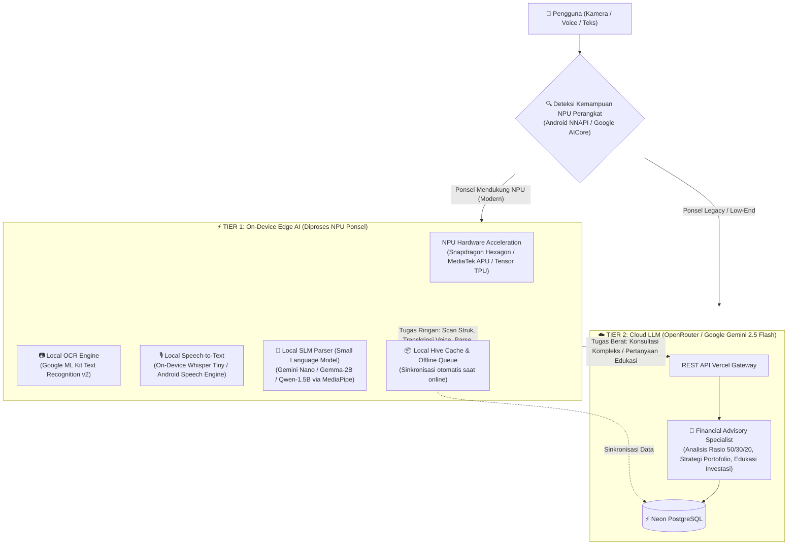

# ⚡ Rencana Arsitektur On-Device AI: Akselerasi NPU pada CatatDuit AI

Dokumen ini merinci cetak biru (*blueprint*) dan rencana transisi arsitektur aplikasi **CatatDuit AI** dari sistem *Pure Cloud LLM* menuju **Hybrid Edge-Cloud AI Architecture** dengan memanfaatkan chip akselerator **NPU (Neural Processing Unit)** pada perangkat ponsel pintar (*smartphone*) Android.

---

## 1. Latar Belakang & Tujuan Strategis

Saat ini, seluruh proses inferensi kecerdasan buatan CatatDuit AI bergantung pada server cloud (Vercel $\rightarrow$ OpenRouter $\rightarrow$ Google Gemini). Meskipun model cloud memiliki wawasan finansial yang sangat luas, model ini memiliki beberapa keterbatasan:
* **Ketergantungan Internet**: Fitur cerdas (Scan Struk, Voice Note, Chat AI) tidak dapat bekerja saat ponsel dalam mode *offline* atau sinyal lemah.
* **Latensi Jaringan (*Network Roundtrip*)**: Upload gambar struk resolusi tinggi membutuhkan waktu 2–5 detik tergantung kecepatan koneksi.
* **Konsumsi Kuota Token Cloud**: Setiap transaksi dan pertanyaan menghabiskan token API OpenRouter.

### 🎯 Tujuan Integrasi NPU:
1. **Latensi Mendekati Nol (< 100 ms)**: Pengguna memindai struk atau berbicara via pesan suara langsung diproses instan di memori ponsel.
2. **Offline-First Resilience**: Pengguna dapat mencatat transaksi lewat foto struk atau suara di pedalaman/pesawat tanpa koneksi internet.
3. **Penghematan Biaya Token Cloud Hingga 75%**: Transaksi harian di-parse lokal oleh NPU; server cloud hanya dipanggil untuk konsultasi finansial mendalam.
4. **Privasi Tingkat Tinggi (*Privacy by Design*)**: Foto nota belanja kasir dan rekaman suara diproses secara lokal tanpa harus diunggah ke server pihak ketiga.

---

## 2. Arsitektur Sistem: *Dual-Tier Hybrid AI*



---

## 3. Komponen Beban Kerja yang Dialihkan ke NPU

### A. 📷 Scan Struk Belanja Instan (On-Device OCR)
* **Kondisi Lama (Cloud)**:
  1. Pengguna memotret nota belanja.
  2. Gambar dikompres dan diubah menjadi Base64 (~1.5 MB).
  3. Base64 dikirim via HTTP POST ke server Vercel $\rightarrow$ OpenRouter Gemini Vision.
  4. Waktu tunggu: **2.500 ms – 4.000 ms**.
* **Dengan Akselerasi NPU (On-Device)**:
  1. Modul **Google ML Kit Text Recognition v2 (Bundled Model)** mengeksekusi ekstraksi teks nota langsung di frame kamera via GPU/NPU ponsel.
  2. Algoritma lokal *Regex Line Parser* membaca nama toko, tanggal, item, dan *Total Bayar*.
  3. Waktu tunggu: **< 80 ms** (40x lebih cepat).
  4. Penggunaan kuota: **0 KB** (Foto tidak pernah meninggalkan memori HP).

### B. 🎙️ Transkripsi Pesan Suara Instan (On-Device STT)
* **Kondisi Lama (Cloud)**:
  1. Audio m4a direkam, di-encode base64, dikirim ke server.
  2. Model multimodal cloud memproses file audio.
* **Dengan Akselerasi NPU (On-Device)**:
  1. Memanfaatkan **Android On-Device Speech Recognizer API** (didukung NPU bahasa Indonesia offline) atau **Whisper.tflite Tiny** via Android NNAPI.
  2. Suara pengguna langsung muncul dalam bentuk teks huruf-per-huruf secara *real-time* (*streaming transcription*).
  3. Latensi: **0 ms delay jaringan**.

### C. 💬 Parsing Bahasa Alami Menggunakan SLM (*Small Language Model*)
* **Model yang Digunakan**:
  * **Google Gemini Nano** (tersedia *native* via Android AICore API di Android 14+).
  * **Google Gemma-2B / Qwen2.5-1.5B Instruct (INT4 Quantized)** via runtime **MediaPipe LLM Inference Engine** (ukuran model ~1.2 GB terkompresi).
* **Fungsi**:
  * Menerjemahkan kalimat gaul/santai: *"tadi siang makan bakso abis 25rb bayar gopay"* $\rightarrow$ JSON `{ "type": "expense", "amount": 25000, "category": "Makanan & Minuman", "wallet": "GoPay" }`.
  * Kecepatan inferensi pada NPU Snapdragon 8 Gen 2/3 atau Dimensity 9200: **25–40 token/detik**.

---

## 4. Hardware Abstraction Layer (HAL) & Deteksi Otomatis

Aplikasi CatatDuit AI akan memiliki modul **DeviceCapabilityService** untuk mendeteksi profil perangkat pengguna secara otomatis:

```dart
enum DeviceAiCapability {
  highEndNpu,    // Mendukung On-Device SLM (Gemini Nano / Gemma 2B) + Local OCR + Local STT
  standardNpu,   // Mendukung Local OCR (ML Kit) + Local STT, LLM diarahkan ke Cloud
  cloudOnly,     // Perangkat lawas / RAM < 3GB, seluruh pemrosesan menggunakan Cloud API
}
```

### Logika Pemilihan Otomatis:
1. **Pemeriksaan Versi OS & RAM**:
   * Jika RAM $\ge$ 6 GB dan OS $\ge$ Android 14 dengan dukungan Google AICore $\rightarrow$ Aktifkan **High-End NPU** (Full On-Device).
   * Jika RAM 3–4 GB dan mendukung Android NNAPI $\rightarrow$ Aktifkan **Standard NPU** (Hybrid: OCR & Voice lokal, Chat ke Cloud).
   * Jika RAM $\le$ 2 GB $\rightarrow$ Mode **Cloud-Only** (mencegah HP pengguna lemot atau panas).
2. **Efisiensi Termal & Baterai**:
   * Jika baterai perangkat $< 15\%$ atau mode *Battery Saver* aktif, NPU dialihkan kembali ke Cloud secara dinamis untuk menghemat daya ponsel.

---

## 5. Peta Jalan Implementasi (Phase-by-Phase Roadmap)

### 📍 Fase 1: Fast On-Device OCR & Voice (Estimasi: Sprint 10)
* Menambahkan plugin `google_mlkit_text_recognition` pada Flutter.
* Membuat parser regex lokal untuk struk kasir Indonesia (*Alfamart, Indomaret, SPBU Pertamina*).
* Mempertahankan Cloud Vision sebagai *fallback* sekunder jika OCR lokal memiliki tingkat keyakinan (*confidence score*) $< 75\%$.

### 📍 Fase 2: Local Speech Recognition (Estimasi: Sprint 11)
* Mengintegrasikan `speech_to_text` offline package dengan dukungan bahasa Indonesia lokal.
* Mengeliminasi pengiriman file audio base64 ke Vercel untuk transaksi suara standar.

### 📍 Fase 3: Integrasi MediaPipe LLM Inference & Gemini Nano (Estimasi: Sprint 12)
* Mengintegrasikan package `mediapipe_genai` pada Flutter.
* Mengunduh bobot model quantized (Gemma-2B-INT4 atau Qwen-1.5B) secara opsional di menu Pengaturan (*Download Offline AI Pack ~800MB*).
* Menjalankan parser transaksi JSON secara 100% lokal di NPU.

### 📍 Fase 4: Offline Transaction Queue & Auto-Sync (Estimasi: Sprint 13)
* Seluruh transaksi yang dicatat saat offline disimpan di storage aman lokal (Hive/SQLite).
* Begitu ponsel mendeteksi koneksi internet kembali, transaksi disinkronkan ke server Neon PostgreSQL dan bot Telegram di latar belakang (*background sync*).

---

## 6. Proyeksi Penghematan Biaya & Performa

| Parameter Metrik | Arsitektur Lama (Pure Cloud) | Arsitektur Baru (NPU Hybrid) | Dampak Efisiensi |
| :--- | :--- | :--- | :--- |
| **Kecepatan Scan Struk** | 2.500 ms – 4.000 ms | **< 100 ms** | **40x Lebih Cepat** |
| **Latensi Voice Note** | 2.000 ms – 3.000 ms | **Instan (< 50 ms)** | **Nol Lag Jaringan** |
| **Konsumsi Kuota Internet** | ~1.5 MB per foto struk | **0 KB** | **100% Hemat Kuota** |
| **Konsumsi Token Cloud** | 100% transaksi menggunakan API | **Hanya 25%** (konsultasi rumit) | **Hemat Biaya API 75%** |
| **Kemampuan Offline** | Tidak bisa digunakan sama sekali | **Pencatatan Berjalan Penuh** | **Tersedia Kapan Saja** |

---

## 7. Kesimpulan & Rekomendasi

Akselerasi NPU adalah **langkah strategis masa depan** untuk membawa CatatDuit AI menjadi aplikasi finansial kelas dunia (*world-class fintech app*). 

Dengan memadukan kecepatan komputasi lokal di NPU untuk tugas-tugas harian yang repetitif (scan nota, suara, catat cepat) dan kemampuan mendalam cloud serverless untuk konsultasi analitis, aplikasi ini akan menjadi **sangat cepat, hemat biaya operasional token, dan dapat diandalkan dalam kondisi jaringan apa pun**.
